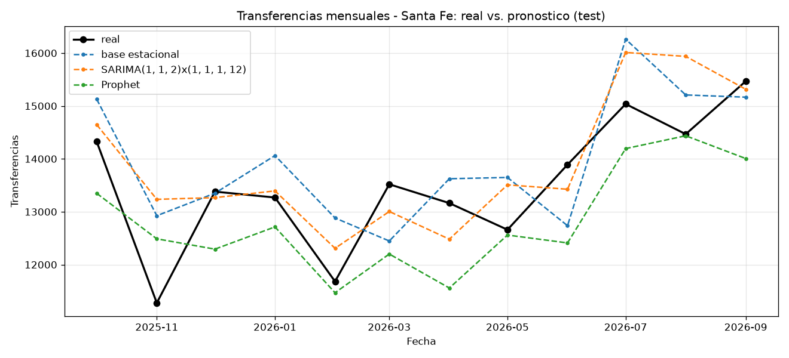
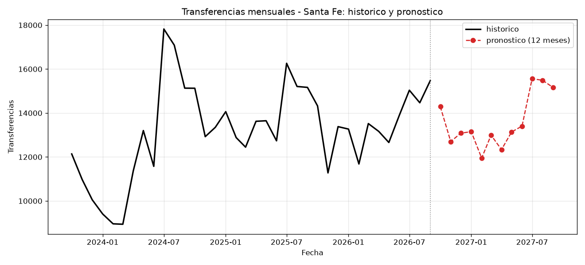

# pronostico-autos

Pronostico de las **transferencias mensuales de automotores en Argentina**, a partir
del CSV oficial de la DNRPA, con una API para consultar los pronosticos.

Proyecto de portfolio de ciencia de datos. Empezamos con **Santa Fe** y luego
extendemos a todas las provincias.

## Datos

- Fuente: [DNRPA - datos.jus.gob.ar](https://datos.jus.gob.ar/dataset/1ab0cc03-ab9b-4520-975c-5757d87d1061)
- Transferencias mensuales por provincia, de **2000-01 a 2026-09**.
- El CSV no se versiona en git; se descarga con un script.

## Resultados

Comparación de los tres modelos sobre el test (**2025-10 a 2026-09**, 12 meses,
con el modelo ajustado solo con datos hasta 2025-09). Todas las métricas salen de
correr `python -m src.train`:

| Modelo | MAE | MAPE |
|---|---|---|
| **SARIMA(1,1,2)(1,1,1,12)** | **687.74** | **5.29 %** |
| base estacional (seasonal naive) | 868.25 | 6.62 % |
| Prophet | 907.12 | 6.70 % |

MAE = error absoluto medio (en transferencias); MAPE = error porcentual absoluto medio.

Real vs. pronóstico en el test:



Histórico (últimos 3 años) y pronóstico a 12 meses:



## Estructura

```
pronostico-autos/
├── data/            # CSV descargado (no versionado)
├── notebooks/       # exploracion
├── src/
│   ├── download_data.py   # descarga el CSV oficial
│   ├── data.py            # carga, limpieza y serie mensual
│   ├── model.py           # clase ModeloSARIMA (version liviana serializable)
│   ├── predict.py         # lectura del modelo + pronostico (runtime de la API)
│   └── train.py           # modelos base / SARIMA / Prophet + metricas
├── reports/         # tabla y graficos (se generan con src/train.py)
├── models/          # modelo entrenado (liviano) + metadatos y metricas
├── api/main.py      # API FastAPI
├── tests/           # tests de la API con pytest
├── requirements.txt       # dependencias de desarrollo (incluye prophet/jupyterlab)
├── requirements-api.txt   # dependencias solo de runtime (imagen Docker liviana)
├── Dockerfile             # imagen de la API
├── render.yaml            # blueprint de deploy en Render
└── README.md
```

## Puesta en marcha

```bash
# 1. Entorno virtual
python -m venv .venv
source .venv/Scripts/activate      # Windows (Git Bash)
# source .venv/bin/activate        # Linux / macOS

# 2. Dependencias
pip install -r requirements.txt

# 3. Descargar los datos
python src/download_data.py

# 4. Ver que todo cargue (imprime la serie de Santa Fe)
python src/data.py

# 5. Comparar modelos + entrenar y guardar el final -> reports/ y models/
python -m src.train
python -m src.train --sin-guardar   # solo comparar (base vs SARIMA vs Prophet)
python -m src.train --base          # solo el modelo base (Etapa 2)
python -m src.train --buscar        # grilla de SARIMA por AIC

# 6. Explorar
jupyter lab notebooks/01_exploracion.ipynb
```

## Uso desde Python

```python
from src.data import load_clean, get_series, split_train_test

datos  = load_clean()                       # fecha, provincia, cantidad
serie  = get_series(datos, "Santa Fe")      # serie mensual continua
train, test = split_train_test(serie, 12)   # test = ultimos 12 meses
```

## Modelo final

El mejor modelo es un **SARIMA(1,1,2)(1,1,1,12)**. `src/train.py` lo entrena y lo
guarda en `models/`:

- `models/sarima_santa_fe.pkl` — modelo entrenado (formato liviano, ~9 KB).
- `models/sarima_santa_fe.json` — metadatos: orden, rangos, metricas y versiones.
- `models/metricas_santa_fe.json` — MAE/MAPE de los 3 modelos (lo lee `/metricas`).

Método: las métricas (**MAE 688 / MAPE 5.29 %**) se miden en el test (fit sobre
train, pronóstico de los 12 meses siguientes). Después, para producción, el modelo
se **reentrena con toda la serie** (2000-01 a 2026-09), que es el que usa la API.

Nota técnica: un `SARIMAXResults` completo pesa ~39 MB y `remove_data()` lo baja a
~6 MB pero rompe el `forecast`. Guardamos solo los parámetros + la serie y
reconstruimos con `SARIMAX.smooth` → pronósticos idénticos en ~9 KB.

```python
from src.train import entrenar_final, pronostico_futuro, cargar_metricas

entrenar_final("Santa Fe", test_meses=12)   # entrena y guarda
pronostico_futuro("Santa Fe", meses=6)      # usa el modelo guardado
cargar_metricas("Santa Fe")                 # metricas de los 3 modelos
```

## API

En producción: https://pronostico-autos.onrender.com — documentación en
https://pronostico-autos.onrender.com/docs. La consume el **Panel** (server-to-server).

```bash
uvicorn api.main:app --reload      # http://127.0.0.1:8000  (docs en /docs)
pytest                             # corre los tests
```

| Endpoint | Descripcion |
|---|---|
| `GET /health` | Chequeo de vida. |
| `GET /pronostico?provincia=Santa%20Fe&meses=6` | Pronostico de los proximos `meses` (mes y valor). |
| `GET /metricas?provincia=Santa%20Fe` | MAE y MAPE de base, SARIMA y Prophet. |

Ejemplo:

```bash
curl "http://127.0.0.1:8000/pronostico?provincia=Santa%20Fe&meses=3"
# {"provincia":"Santa Fe","modelo":"SARIMA","detalle_modelo":"SARIMA(1, 1, 2)x(1, 1, 1, 12)",
#  "entrenado_hasta":"2026-09-01",
#  "pronostico":[{"mes":"2026-10","valor":14291},{"mes":"2026-11","valor":12701},
#                {"mes":"2026-12","valor":13084}]}
```

## Docker

Imagen liviana (solo `requirements-api.txt`, sin matplotlib/prophet/jupyterlab):

```bash
docker build -t pronostico-autos .
docker run -p 8000:8000 pronostico-autos
# http://localhost:8000/health
```

## Deploy en Render (plan free)

El servicio está desplegado en **Render** (plan free):

**URL:** https://pronostico-autos.onrender.com

**Documentación interactiva (Swagger UI):** https://pronostico-autos.onrender.com/docs

Está API la consume mi **Panel**, server-to-server (por eso no habilito CORS);
en particular usa el endpoint [`/metricas`](https://pronostico-autos.onrender.com/metricas?provincia=Santa%20Fe)
para mostrar la comparación de modelos.

> **Nota importante:** en el plan free Render **duerme el servicio tras ~15 minutos
> sin uso**. La **primera respuesta después de dormido tarda ~30-60 segundos**
> (cold start). Las siguientes son inmediatas. Si el panel no responde al toque,
> esperá unos segundos y volvé a intentar.

Pasos (una sola vez):

1. Subir el repo a GitHub.
2. En Render: **New + → Blueprint**, elegir el repo. Toma `render.yaml` automáticamente
   (Web Service con Docker, `plan: free`, health check en `/health`).
3. Esperar el primer build y listo.

Como el modelo (`models/sarima_santa_fe.pkl`) está versionado, la imagen no entrena
nada: solo sirve los pronósticos.

## Etapas

- [x] **1.** Estructura, entorno, descarga y limpieza. Split train/test.
- [x] **2.** Modelo base estacional + metricas (MAE, MAPE).
- [x] **3.** SARIMA y Prophet vs. base (tabla y graficos).
- [x] **4.** Guardar el mejor modelo y hacer `train.py` reproducible.
- [x] **5.** API FastAPI (`/pronostico`, `/health`, `/metricas`) + tests con pytest.
- [x] **6.** Docker, deploy en Render y README final con resultados.
